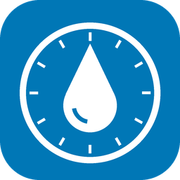

<p align="center">
  
</p>

<h1 align="center">South West Water for Home Assistant</h1>

<p align="center">
  Smart meter water usage and cost tracking in Home Assistant, ready for the Energy dashboard.
</p>

<p align="center">
  <a href="https://github.com/kieran-tanner-9/homeassistant-south-west-water/releases"></a>
  <a href="https://hacs.xyz"></a>
  <a href="https://github.com/kieran-tanner-9/homeassistant-south-west-water/actions/workflows/validate.yml"></a>
  <a href="https://github.com/kieran-tanner-9/homeassistant-south-west-water/actions/workflows/lint.yml"></a>
  <a href="https://github.com/kieran-tanner-9/homeassistant-south-west-water/actions/workflows/tests.yml"></a>
  <a href="LICENSE"></a>
  <a href="https://buymeacoffee.com/kierantanner9"></a>
</p>

<p align="center">
  <a href="https://my.home-assistant.io/redirect/hacs_repository/?owner=kieran-tanner-9&repository=homeassistant-south-west-water&category=integration"></a>
  <a href="https://my.home-assistant.io/redirect/config_flow_start/?domain=south_west_water"></a>
</p>

> [!WARNING]
> **Unofficial.** Not affiliated with South West Water. It uses an undocumented
> web API that may change or stop working without notice.

## Features

- 💧 **Water usage sensor** in m³ (`water` device class, `total_increasing`), fully compatible with the Energy dashboard.
- 💷 **Cost tracking**:
  - **Water cost**: Cumulative volumetric usage cost (`monetary` device class), usable directly in the Energy dashboard.
  - **Volumetric rate**: Combined clean water & sewerage rate per m³.
  - **Standing charge**: Accumulated year-to-date fixed charges.
  - **Total cost**: Overall estimated water bill year-to-date (usage + standing charges).
- ⚙️ **Customizable tariffs**: Set your water supply, sewerage, and daily standing charges. Pre-filled with standard South West Water metered rates, easily adjustable if you have a septic tank (no sewerage charge) or special allowances/discounts.
- 🔄 **Options flow**: When annual rates change around April 1st, click **Configure** in Home Assistant to update your tariffs instantly.
- 🔌 **One device** per meter, set up entirely from the UI.
- 🔁 **Re-authentication prompt** if your password ever changes.
- 🕒 Polls every 6 hours, with a `last_reading` attribute showing when the utility last read the meter.
- 🔒 Credentials and meter reference are automatically redacted from diagnostics.

## Requirements

- Home Assistant 2026.10 or later
- A South West Water **My Account** login with a smart meter

## Installation (HACS)

1. Click **Open in HACS** above, or in HACS open the menu → **Custom repositories** and add
   `https://github.com/kieran-tanner-9/homeassistant-south-west-water` as type **Integration**.
2. Download **South West Water** and restart Home Assistant.
3. Go to **Settings → Devices & services → Add integration** and choose **South West Water**.

## Energy Dashboard Setup

1. In Home Assistant, navigate to **Settings → Dashboards → Energy**.
2. Under **Water consumption**, click **Add water source** (or edit your existing meter).
3. Select `sensor.south_west_water_water_usage`.
4. Under **Water cost**, choose:
   - **"Use an entity tracking the total costs"** and select `sensor.south_west_water_water_cost`, OR
   - **"Use an entity with current price"** and select `sensor.south_west_water_volumetric_rate`.
5. Click **Save**.

## Configuration & Tariffs

| Setting | Default | Description |
| --- | --- | --- |
| **Username or email** | — | What you sign in with on the South West Water website |
| **Password** | — | Your My Account password |
| **Meter reference** | — | Smart meter reference number |
| **Water supply rate** | £2.7129 / m³ | Clean water rate per m³ |
| **Sewerage rate** | £3.8440 / m³ | Wastewater rate per m³ (set to 0 if on a septic tank) |
| **Water standing charge** | £0.1630 / day | Daily service charge for clean water |
| **Sewerage standing charge** | £0.2073 / day | Daily service charge for wastewater (set to 0 if on a septic tank) |

> [!NOTE]
> The usage total is **year-to-date** and restarts each 1 January. Home Assistant
> treats that drop as a meter reset, so long-term statistics keep adding up smoothly.

## Troubleshooting

### Why did my water usage drop to 0 or become unavailable?

South West Water's web API occasionally returns an empty or unauthenticated payload (reporting `0.0 m³` and a default date of `0001-01-01`) if the server session expires between polling intervals or if the utility's smart meter backend is temporarily unable to retrieve fresh meter data.

The integration automatically detects this, rejects empty or dropped payloads, and preserves your last valid reading across transient poll failures to ensure your Home Assistant Energy dashboard statistics are never corrupted by zero readings. If multiple consecutive polls fail, the sensor transitions to `unavailable` until valid readings resume.

### Debug Logging

If the integration fails to set up or update, enable debug logging and check the log:

```yaml
logger:
  logs:
    custom_components.south_west_water: debug
```

The log records HTTP status codes, poll date windows, response keys, and parsed totals—never your credentials, tokens, or meter references.

## Support

If this integration helps you track your water usage and bills, consider buying a coffee!

<a href="https://buymeacoffee.com/kierantanner9"></a>

## Disclaimer

This project is not endorsed by or connected to South West Water. Use at your own risk.
